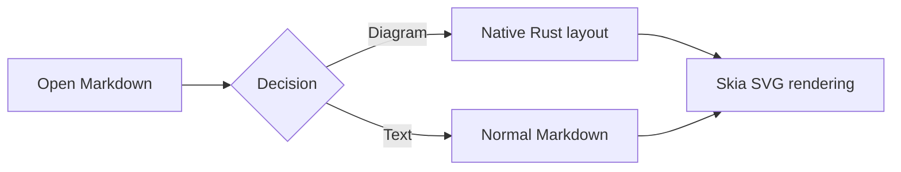
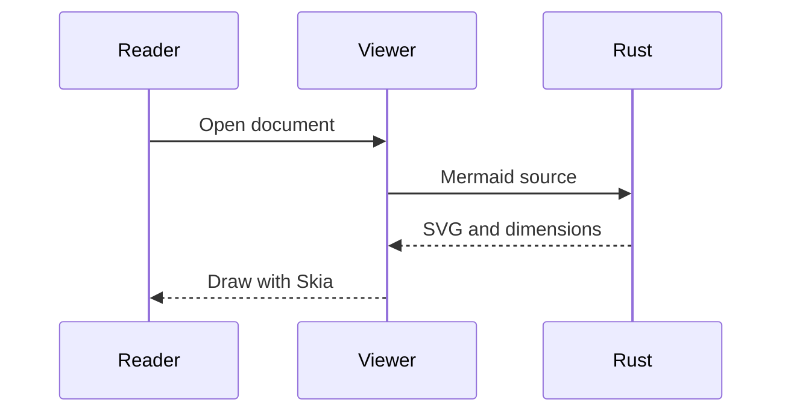
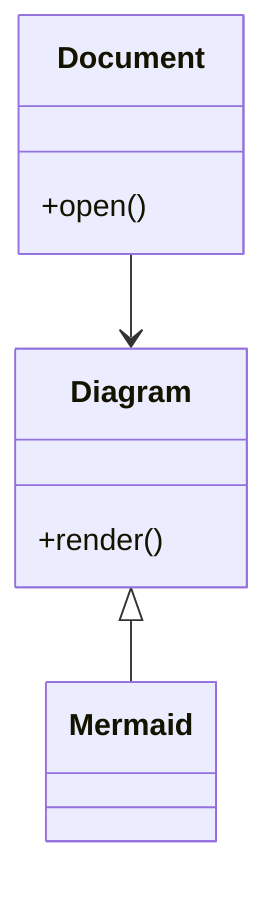
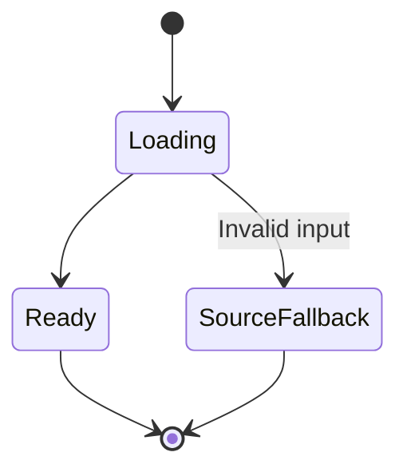
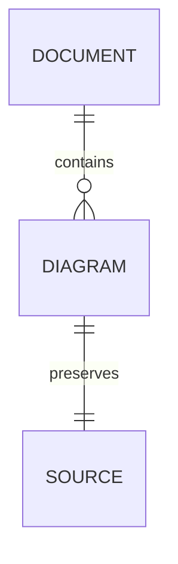
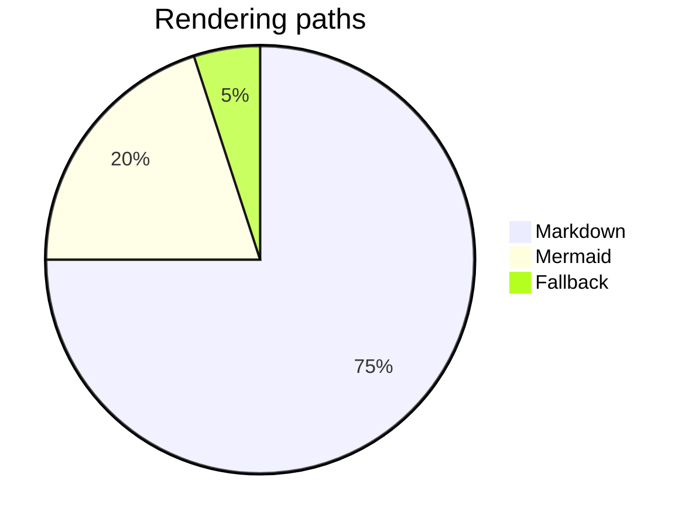
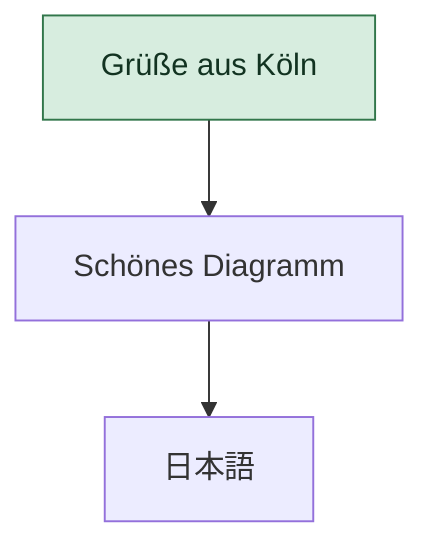
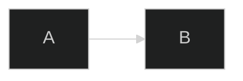

# Native Mermaid diagrams

This fixture exercises the Rust SVG renderer. Check light, sepia and dark themes,
reader zoom, narrow windows, source copying, searching for `Decision`, and PDF
export. Arrowheads must remain visible. The two final examples must show source
and an explanation instead of disappearing.

## Flowchart



## Sequence



## Class diagram



## State diagram



## Entity relationship



## Pie chart



## Styling and Unicode



## Nested diagram

> Diagram inside a blockquote:
>
> ```mermaid
> flowchart LR
>     A[Shared layout] --> B[Windows and Linux]
> ```

## Invalid source fallback

```mermaid
this-is-not-a-diagram
```

## Unsupported configuration fallback



Ordinary text after the diagrams must remain visible and selectable.
